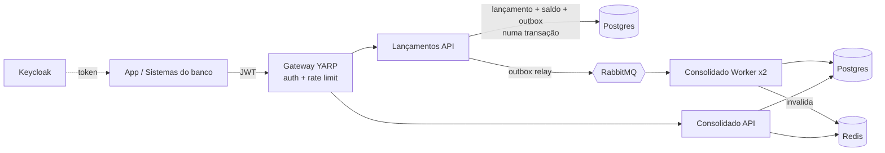

# Ledger Financeiro

Razão financeiro para um banco digital: registra movimentações (créditos e débitos) de contas digitais e cartões de crédito e fornece a posição consolidada do saldo em qualquer momento. Projetado para continuar operando com falhas parciais, picos de demanda e dados sensíveis.

> Desafio técnico de Arquiteto de Software. A documentação de arquitetura está em [`docs/arquitetura.md`](docs/arquitetura.md) e as decisões em [`docs/adr`](docs/adr).

## Visão rápida



- **Lançamentos** continua aceitando movimentações mesmo com o Consolidado fora do ar (Outbox + fila durável).
- **Consolidado** responde saldo atual, consolidado diário e saldo em um instante, com cache e consistência eventual explícita (`posicaoEm`).

## Como executar

Pré-requisito: Docker com Compose v2.

```bash
docker compose up -d --build --wait
./scripts/e2e.sh        # cria as contas da demonstração e executa o roteiro ponta a ponta
```

| Serviço | Endereço |
|---|---|
| Gateway (entrada da API) | http://localhost:5000 |
| Keycloak (admin / admin) | http://localhost:8080 |
| RabbitMQ (ledger / ledger) | http://localhost:15672 |
| Traces, métricas e logs (Aspire Dashboard) | http://localhost:18888 |

### Usuários e clientes da demonstração

| Quem | Como obter o token |
|---|---|
| Ana (cliente) | `password` grant, client `app-canais`, usuário `ana` / `ana123` |
| Bruno (cliente) | `password` grant, client `app-canais`, usuário `bruno` / `bruno123` |
| Backoffice (sistemas internos) | `client_credentials`, client `backoffice`, segredo `backoffice-secret-dev` |

```bash
TOKEN=$(curl -s http://localhost:8080/realms/ledger/protocol/openid-connect/token \
  -d grant_type=password -d client_id=app-canais -d username=ana -d password=ana123 | jq -r .access_token)

source scripts/dados-demo.env
curl -s http://localhost:5000/contas/$CONTA_ANA/saldo -H "Authorization: Bearer $TOKEN" | jq
```

> Credenciais e segredos acima são exclusivamente de desenvolvimento local.

## Testes

```bash
dotnet test LedgerFinanceiro.slnx      # unitários e integração (Testcontainers: precisa de Docker)
./scripts/e2e.sh                       # ponta a ponta contra o docker compose
./scripts/carga.sh                     # carga com k6 (em container)
dotnet tool install -g dotnet-stryker && (cd tests/Lancamentos.UnitTests && dotnet stryker)   # mutação
```

A CI (GitHub Actions) compila com warnings tratados como erro, roda os 121 testes, executa o E2E e o teste de carga com o ambiente completo e os testes de mutação. Resultados e metodologia: [`docs/qualidade-e-desempenho.md`](docs/qualidade-e-desempenho.md).

| Indicador | Resultado |
|---|---|
| Pico de 50 req/s no Consolidado | **0% de perda**, p95 de 5,5 ms (requisito: até 5% de perda) |
| Estresse até 1.000 req/s | 0% de perda |
| Score de mutação | 98,8% (Lançamentos) e 100% (Consolidado) |

## Estrutura

```
src/
  BuildingBlocks/   contratos de eventos, mensageria, Postgres, segurança, observabilidade
  Lancamentos/      Domain, Application, Infrastructure, Api
  Consolidado/      Core, Infrastructure, Api, Worker
  Gateway/          YARP + rate limiting
tests/              unitários, integração (Testcontainers) e gateway
deploy/             Keycloak, RabbitMQ, Postgres
scripts/            E2E e dados de demonstração
docs/               arquitetura e ADRs
```
