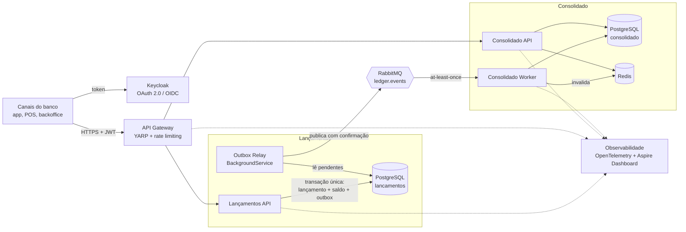
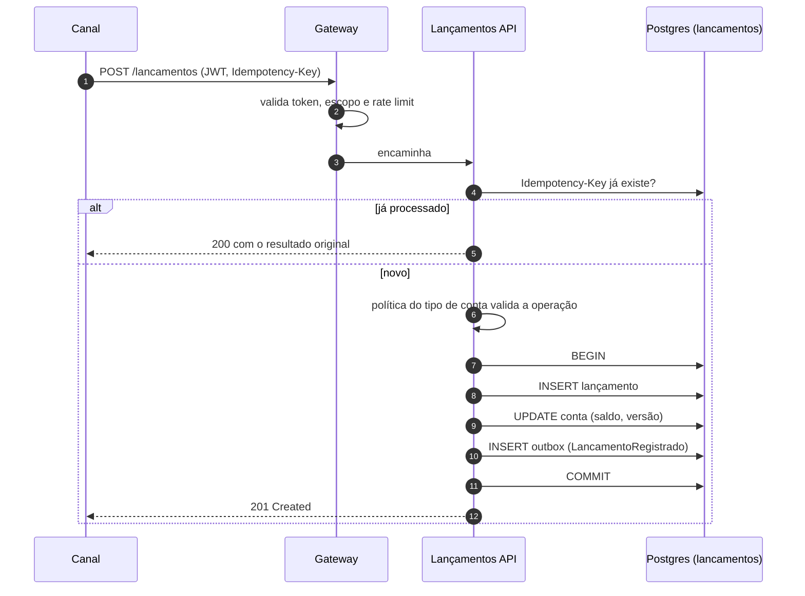
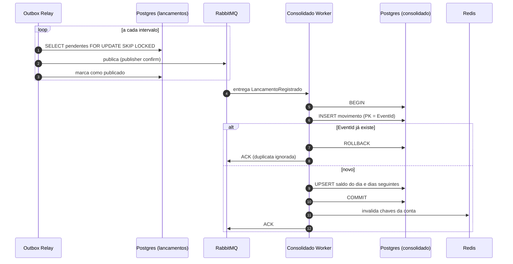
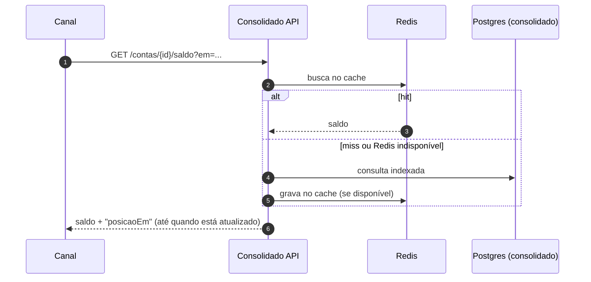
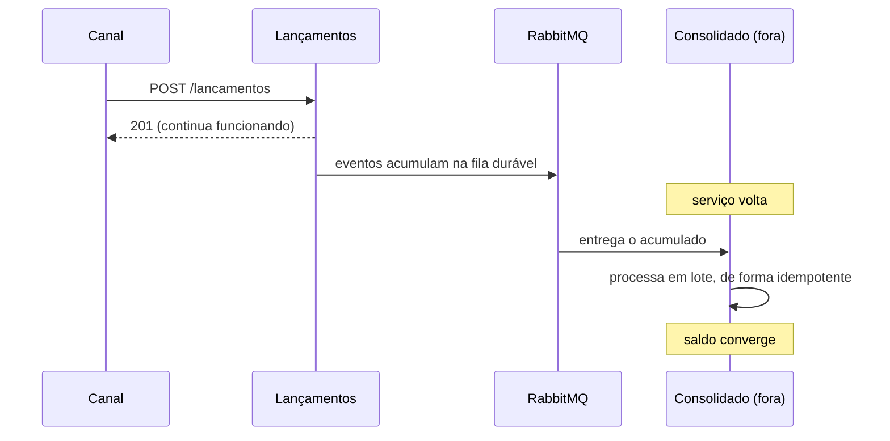

# Documento de Arquitetura

> Status: rascunho para validação (checkpoint 1)

## 1. O problema

Um banco precisa:

1. **Registrar movimentações financeiras** (créditos e débitos) nas contas dos clientes;
2. **Consultar a posição consolidada** (saldo) de um cliente em um determinado momento;
3. **Continuar operando** com instabilidade, picos de demanda ou falhas parciais, sem gerar inconsistência.

O sistema atual cresceu sem planejamento, é lento em horário de pico e difícil de manter. A proposta é repensar a solução do zero.

### 1.1 Reconciliação entre o enunciado e as orientações recebidas

O enunciado (PDF, versão set/26) fala em "movimentações" e "posição consolidada em um determinado momento". As orientações recebidas por e-mail usam outro vocabulário: "serviço de controle de lançamentos" e "consolidado diário". Tratamos os dois como o mesmo problema:

| Enunciado | Orientações | Nesta solução |
|---|---|---|
| Registrar movimentações | Controle de lançamentos | Serviço **Lançamentos** (lado de escrita) |
| Posição consolidada em um momento | Consolidado diário | Serviço **Consolidado** (lado de leitura) |

O Consolidado guarda uma "fotografia" por conta e por dia. O saldo em um instante qualquer é calculado como:

```
saldo(conta, instante) = saldo no fim do dia anterior + movimentos do dia até o instante
```

Assim atendemos ao "consolidado diário" e ao "saldo em um determinado momento" com o mesmo modelo.

### 1.2 Contexto do negócio

O cliente é um banco ligado a uma rede varejista, cujo principal produto é cartão de crédito, com produtos de conta/carteira digital em expansão. A solução trata os dois tipos de conta:

| | Conta digital | Cartão de crédito |
|---|---|---|
| Créditos | depósito, Pix recebido | pagamento de fatura, estorno de compra |
| Débitos | saque, Pix enviado, pagamento | compra |
| Limite | cheque especial (pode ser zero) | limite de crédito |

O núcleo (registro, saldo, concorrência, publicação de eventos) é único. As regras de cada produto ficam em **políticas por tipo de conta** (ver [ADR 0005](adr/0005-politicas-por-tipo-de-conta.md)).

## 2. Requisitos não funcionais e metas

| Requisito | Meta | Como verificamos |
|---|---|---|
| Disponibilidade de Lançamentos independente do Consolidado | Lançamentos aceita movimentações com o Consolidado fora do ar | Teste E2E de falha |
| Throughput do Consolidado | 50 req/s sustentados | Teste de carga k6 |
| Perda de requisições no pico | no máximo 5% (meta interna: abaixo de 1%) | Threshold do k6 |
| Latência de consulta | p95 abaixo de 200 ms | Threshold do k6 |
| Durabilidade | Nenhum lançamento confirmado (HTTP 201) é perdido | Outbox na mesma transação; testes de integração |
| Idempotência | Reenvio de um mesmo lançamento não duplica valores | Testes de API e de consumidor |
| Defasagem do consolidado | p95 abaixo de 2 s em operação normal | Métrica de lag e teste E2E |
| Consistência do saldo de autorização | Duas operações simultâneas não ultrapassam o limite | Teste de concorrência |

> "Perda", aqui, é qualquer requisição que não recebe resposta de sucesso (erro 5xx, timeout ou rejeição por sobrecarga).

## 3. Visão de containers



| Container | Responsabilidade | Escala |
|---|---|---|
| API Gateway | Ponto único de entrada: valida token, limita taxa, roteia | Horizontal, sem estado |
| Lançamentos API | Recebe movimentações, aplica regras, grava lançamento, saldo e evento | Horizontal, sem estado |
| Outbox Relay | Publica eventos pendentes no broker | Horizontal (com `SKIP LOCKED`) |
| Consolidado Worker | Consome eventos e atualiza saldos diários | Horizontal (projeção comutativa) |
| Consolidado API | Responde consultas de saldo | Horizontal, sem estado, com cache |

## 4. Fluxos principais

### 4.1 Registrar um lançamento



Se a versão da conta mudou entre a leitura e a gravação (outra operação concorrente), o banco rejeita o UPDATE, a transação é desfeita e a operação é refeita com o saldo atualizado. Ver [ADR 0004](adr/0004-saldo-oficial-e-concorrencia-otimista.md).

### 4.2 Propagar para o Consolidado



Falhas transitórias geram nova tentativa com espera crescente. Depois de N tentativas a mensagem vai para a fila de mensagens mortas (DLQ) para análise e reprocessamento manual.

### 4.3 Consultar saldo



A resposta informa até qual momento o saldo está consolidado. Isso deixa explícita a consistência eventual para quem consome.

### 4.4 Consolidado fora do ar



## 5. Modos de falha

| Falha | Efeito | Mitigação |
|---|---|---|
| Consolidado API ou Worker fora | Consultas falham; lançamentos seguem | Fila durável; Worker reprocessa ao voltar |
| RabbitMQ fora | Eventos ficam na outbox; lançamentos seguem | Relay tenta de novo; nada se perde |
| Postgres de Lançamentos fora | Novos lançamentos são recusados (503) | Não aceitamos o que não conseguimos gravar; réplica e failover em produção |
| Redis fora | Consultas vão direto ao banco | Cache é otimização, nunca dependência |
| Mensagem duplicada | Nenhum efeito | Chave única por EventId |
| Mensagem que sempre falha | Isolada | DLQ após N tentativas, sem travar a fila |
| Cliente reenvia após timeout | Nenhum efeito | Idempotency-Key |
| Duas compras simultâneas no limite | Uma é recusada | Concorrência otimista na conta |
| Pico acima da capacidade | Excesso recebe 429 | Rate limiting no gateway; escala horizontal |

## 6. Segurança

- **Autenticação**: OAuth 2.0 com tokens JWT de vida curta emitidos pelo Keycloak.
- **Autorização**: escopos por capacidade (`lancamentos:write`, `saldo:read`, `contas:admin`) validados no gateway e de novo em cada serviço (defesa em profundidade).
- **Entrada**: validação de todos os campos; valores monetários em `decimal` com duas casas; limites de tamanho.
- **Dados sensíveis**: o razão guarda apenas identificadores de conta, sem dados pessoais. Logs não registram corpo de requisição nem token. Em produção: TLS em todo tráfego, criptografia em repouso e segredos em cofre (ex.: Azure Key Vault).
- **Proteção contra abuso**: rate limiting por cliente no gateway.

## 7. Escalabilidade

- Todos os serviços HTTP são sem estado e escalam horizontalmente.
- O Worker escala horizontalmente porque a projeção é **comutativa**: somar créditos e débitos dá o mesmo resultado em qualquer ordem. Não precisamos garantir ordem de entrega por conta.
- A consulta de saldo é uma leitura por chave indexada `(conta_id, dia)` e passa pelo cache.

## 8. Decisões arquiteturais (ADRs)

| # | Decisão |
|---|---|
| [0001](adr/0001-dois-servicos-e-broker.md) | Dois serviços independentes comunicando por broker |
| [0002](adr/0002-outbox-e-entrega-at-least-once.md) | Outbox Pattern e entrega pelo menos uma vez |
| [0003](adr/0003-idempotencia-ponta-a-ponta.md) | Idempotência na API e no consumidor |
| [0004](adr/0004-saldo-oficial-e-concorrencia-otimista.md) | Saldo oficial em Lançamentos com concorrência otimista |
| [0005](adr/0005-politicas-por-tipo-de-conta.md) | Regras separadas por tipo de conta |
| [0006](adr/0006-rabbitmq.md) | RabbitMQ com client oficial |
| [0007](adr/0007-postgresql-banco-por-servico.md) | PostgreSQL, um banco por serviço |
| [0008](adr/0008-api-gateway.md) | API Gateway com YARP e rate limiting |
| [0009](adr/0009-autenticacao-oauth2-keycloak.md) | OAuth 2.0 / JWT com Keycloak e escopos |
| [0010](adr/0010-lancamentos-imutaveis.md) | Lançamentos imutáveis, correção por estorno |
| [0011](adr/0011-cache-redis.md) | Cache Redis no Consolidado |
| [0012](adr/0012-observabilidade.md) | Observabilidade com OpenTelemetry |

## 9. Fora do escopo e evoluções

- Ciclo de fatura, parcelamento e juros do cartão.
- Transferência entre contas como operação atômica (hoje seriam dois lançamentos coordenados; evolução: saga).
- Fechamento contábil diário com conciliação automática entre o saldo de Lançamentos e o do Consolidado.
- Particionamento da tabela de lançamentos por data quando o volume crescer.
- Kubernetes com autoscaling por métrica de fila (KEDA) para o Worker.
