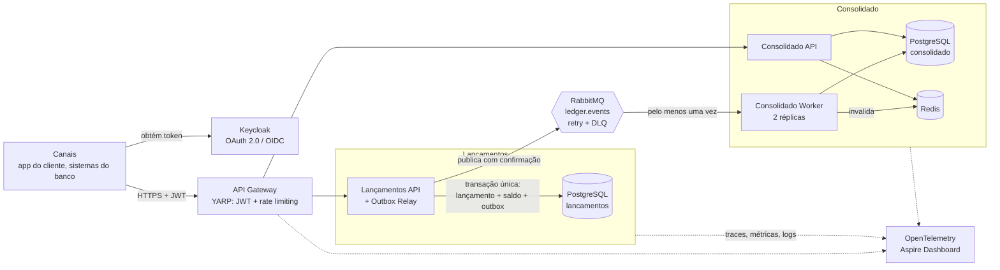
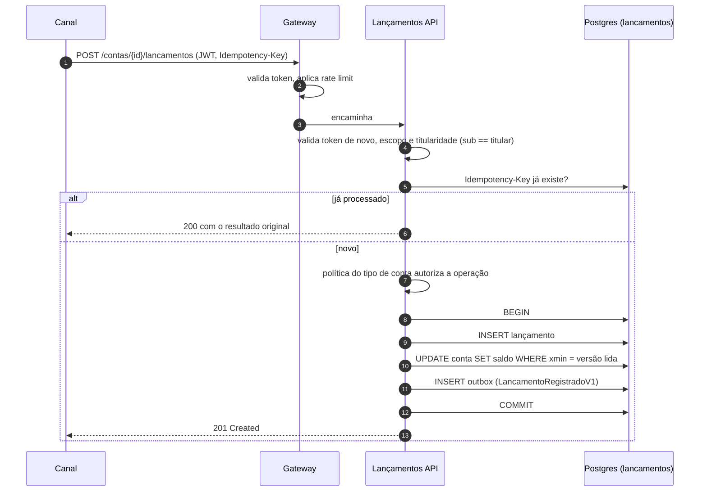
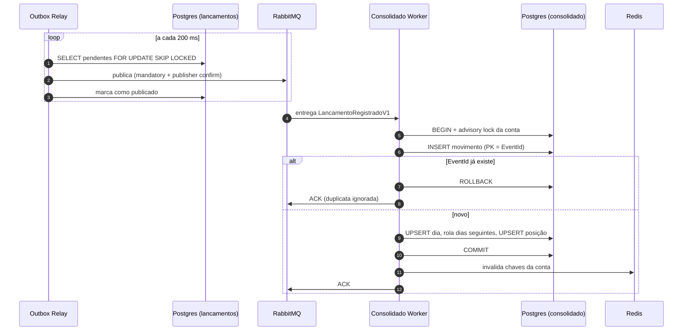
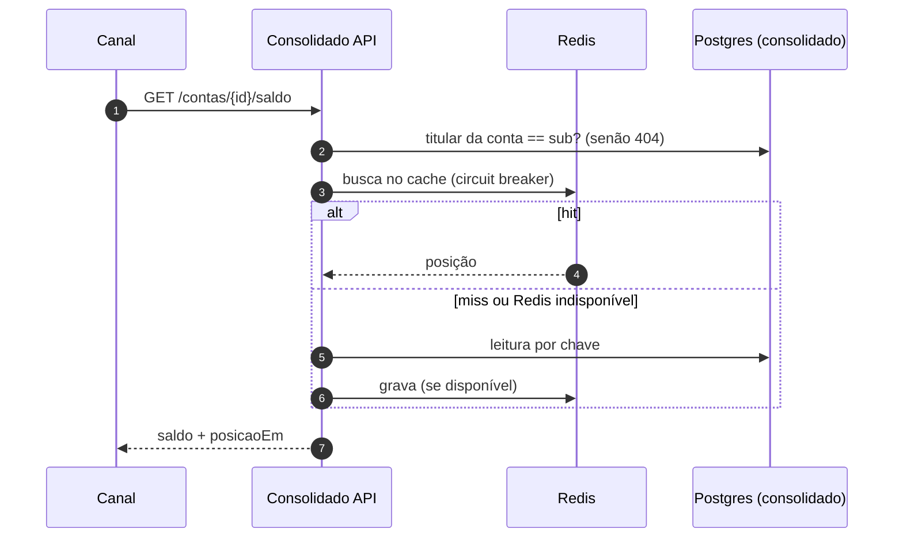
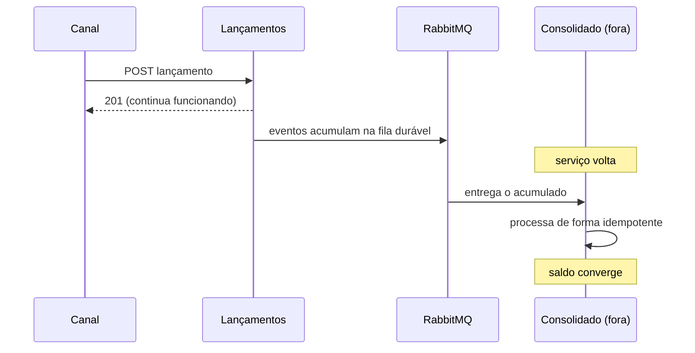

# Documento de Arquitetura

## 1. O problema

Um banco precisa:

1. **Registrar movimentações financeiras** (créditos e débitos) nas contas dos clientes;
2. **Consultar a posição consolidada** (saldo) de um cliente em um determinado momento;
3. **Continuar operando** com instabilidade, picos de demanda ou falhas parciais, sem gerar inconsistência.

O sistema atual cresceu sem planejamento, é lento em horário de pico e difícil de manter. A proposta repensa a solução do zero.

### 1.1 Reconciliação entre o enunciado e as orientações recebidas

O enunciado fala em "movimentações" e "posição consolidada em um determinado momento". As orientações recebidas por e-mail usam outro vocabulário: "serviço de controle de lançamentos" e "consolidado diário". Os dois textos descrevem o mesmo problema:

| Enunciado | Orientações | Nesta solução |
|---|---|---|
| Registrar movimentações | Controle de lançamentos | Serviço **Lançamentos** (lado de escrita) |
| Posição consolidada em um momento | Consolidado diário | Serviço **Consolidado** (lado de leitura) |

O Consolidado guarda uma "fotografia" por conta e por dia contábil. O saldo em qualquer instante é:

```
saldo(conta, instante) = saldo no fim do dia anterior + movimentos do dia até o instante
```

Assim o mesmo modelo atende ao consolidado diário e ao saldo em um momento qualquer.

### 1.2 Contexto do negócio

O cliente é um banco cujo principal produto é cartão de crédito, com conta digital em expansão. A solução trata os dois:

| | Conta digital | Cartão de crédito |
|---|---|---|
| Créditos | depósito, Pix recebido | pagamento de fatura, estorno |
| Débitos | saque, Pix enviado | compra |
| Limite | cheque especial (pode ser zero) | limite de crédito |
| Autorização de débito | `saldo + cheque especial >= valor` | `limite + saldo >= valor` (saldo negativo = utilizado) |

O núcleo do razão (lançamento, saldo, concorrência, outbox) é único. As regras de cada produto ficam em **políticas por tipo de conta** ([ADR 0005](adr/0005-politicas-por-tipo-de-conta.md)).

## 2. Requisitos não funcionais: metas e resultados

| Requisito | Meta | Resultado | Evidência |
|---|---|---|---|
| Lançamentos disponível com o Consolidado fora | Aceita movimentações | Atendido | Integração e E2E derrubam o Consolidado |
| Throughput do Consolidado | 50 req/s | 50 req/s sustentados; estresse até 1.000 req/s | k6 na CI |
| Perda no pico | no máximo 5% (meta interna: abaixo de 1%) | **0%** | k6 na CI |
| Latência de consulta | p95 abaixo de 200 ms | p95 de 5,5 ms (ambiente de CI, ver ressalvas) | k6 na CI |
| Durabilidade | Nenhum lançamento confirmado (201) se perde | Atendido | Outbox na mesma transação; teste com broker fora |
| Idempotência | Reenvio não duplica | Atendido | Integração e E2E |
| Concorrência | Operações simultâneas não ultrapassam o limite | Atendido | 30 compras simultâneas contra o mesmo limite |
| Defasagem do consolidado | p95 abaixo de 2 s em operação normal | Medida pela métrica `ledger.consolidado.defasagem` | Observabilidade |
| Segurança | Autenticação, autorização, titularidade | Atendido | Testes de segurança e E2E com Keycloak |
| Qualidade dos testes | Testes detectam defeitos | Mutação: 98,8% e 100% | Stryker na CI |

Detalhes, metodologia e ressalvas: [qualidade-e-desempenho.md](qualidade-e-desempenho.md).

## 3. Visão de containers



| Container | Responsabilidade | Escala |
|---|---|---|
| API Gateway | Valida token, limita taxa por cliente, roteia | Horizontal, sem estado |
| Lançamentos API | Recebe movimentações, aplica regras, grava lançamento, saldo e evento; publica a outbox | Horizontal (outbox com `SKIP LOCKED`) |
| Consolidado Worker | Consome eventos e atualiza as projeções | Horizontal (projeção comutativa, trava por conta) |
| Consolidado API | Responde consultas de saldo | Horizontal, sem estado, com cache |
| Keycloak | Emite tokens; não guarda dados de negócio | Cluster em produção |

### 3.1 Organização do código

Cada serviço segue camadas com dependências apontando para dentro: **Domínio** (regras puras, sem pacotes externos), **Aplicação** (casos de uso e portas), **Infraestrutura** (banco, broker, cache) e **API**. Bibliotecas compartilhadas em `BuildingBlocks` contêm apenas o que é transversal: contratos de eventos versionados, mensageria, migrações, segurança e telemetria. Nenhuma regra de negócio é compartilhada entre os serviços.

## 4. Fluxos principais

### 4.1 Registrar um lançamento



Se outra operação alterou a conta entre a leitura e a gravação, o UPDATE não afeta nenhuma linha, a transação é desfeita e a operação é refeita com o saldo novo (até 4 tentativas). Ver [ADR 0004](adr/0004-saldo-oficial-e-concorrencia-otimista.md).

### 4.2 Propagar para o Consolidado



Falha transitória: a mensagem é republicada na fila de retry com atraso e volta à fila principal. Depois de 5 tentativas, ou se for inválida, vai para a DLQ.

### 4.3 Consultar saldo



`posicaoEm` informa até qual lançamento o saldo está consolidado: a consistência eventual fica explícita para quem consome.

### 4.4 Consolidado fora do ar



## 5. Modelo de dados

**Lançamentos** (`lancamentos`)
- `contas`: id, titular_id, tipo, saldo, limite, aberta_em. Versão via coluna de sistema `xmin`.
- `lancamentos`: imutáveis. Únicos: `(conta_id, idempotency_key)` e `lancamento_original_id` (estorno único).
- `outbox`: eventos pendentes, com índice parcial só sobre os não publicados.

**Consolidado** (`consolidado`)
- `movimentos`: um por evento, chave primária `event_id` (idempotência). Responde o saldo em um instante.
- `saldos_diarios`: uma linha por conta e dia contábil (fuso de Brasília). Responde o consolidado diário.
- `posicoes`: uma linha por conta, com o titular. Responde o saldo atual e a checagem de titularidade.

Valores monetários são sempre `numeric(18,2)` / `decimal`. Migrações em SQL versionado, aplicadas com trava para várias instâncias.

## 6. Modos de falha

| Falha | Efeito | Mitigação |
|---|---|---|
| Consolidado (API ou Worker) fora | Consultas falham; lançamentos seguem | Fila durável; Worker reprocessa ao voltar |
| RabbitMQ fora | Eventos ficam na outbox; lançamentos seguem | Relay tenta de novo com backoff; nada se perde |
| Postgres de Lançamentos fora | Novos lançamentos recusados (erro 5xx) | Não se aceita o que não se consegue gravar; réplica e failover em produção |
| Redis fora | Consultas vão ao banco | Circuit breaker; cache nunca é dependência |
| Mensagem duplicada | Nenhum efeito | Chave primária por EventId |
| Mensagem que sempre falha | Isolada | DLQ após 5 tentativas, sem travar a fila |
| Evento atrasado | Saldos posteriores recalculados | Rolamento dos dias seguintes com trava por conta |
| Cliente reenvia após timeout | Nenhum efeito | Idempotency-Key |
| Compras simultâneas no limite | Excedentes recusadas | Concorrência otimista na conta |
| Pico acima da capacidade | Excesso recebe 429 | Rate limiting por cliente; escala horizontal |
| Keycloak fora | Novos tokens não são emitidos | Tokens já emitidos seguem válidos até expirar (5 min); chaves em cache nos serviços |

## 7. Segurança

- **Autenticação:** OAuth 2.0 / OIDC com Keycloak, JWT de 5 minutos. Sistemas internos usam *client credentials*; o aplicativo, Authorization Code + PKCE.
- **Autorização em três níveis:** escopo (o que o aplicativo pode fazer), titularidade (de quem é a conta) e operação (o cliente só inicia Pix enviado, saque e pagamento de fatura; créditos e compras chegam por sistemas do banco).
- **O token identifica, o domínio autoriza:** o titular fica na conta, não no token. Conta alheia responde 404, para não revelar que existe.
- **Defesa em profundidade:** o gateway valida o token e limita a taxa; cada serviço valida de novo e autoriza.
- **Entrada:** valores com no máximo duas casas e teto; tamanhos máximos; enums validados; erros em Problem Details com código estável.
- **Dados sensíveis:** o razão guarda identificadores, não dados pessoais. Logs sem corpo de requisição nem tokens. Containers sem root.
- **Cadeia de dependências:** auditoria do NuGet com warnings como erro bloqueou três dependências vulneráveis durante o desenvolvimento (SSH.NET e OpenTelemetry), corrigidas com versões fixadas.
- **Em produção:** TLS em todo tráfego, criptografia em repouso, segredos em cofre, password grant desligado.

Detalhes: [ADR 0009](adr/0009-autenticacao-oauth2-keycloak.md) e [ADR 0008](adr/0008-api-gateway.md).

## 8. Escalabilidade

- Serviços HTTP sem estado escalam horizontalmente atrás do gateway.
- O Worker escala porque a projeção é comutativa; eventos da mesma conta são serializados por trava no banco e contas diferentes seguem em paralelo. O compose já sobe duas réplicas.
- O relay da outbox pode rodar em várias instâncias (`SKIP LOCKED`).
- Consultas são leituras por chave indexada, com cache. O estresse chegou a 1.000 req/s sem perda num único host.

## 9. Observabilidade

Um trace atravessa gateway, API, outbox, RabbitMQ e Worker (contexto propagado na outbox e nos cabeçalhos das mensagens). Métricas de negócio: lançamentos registrados e recusados, eventos publicados, tamanho e idade da outbox, defasagem da consolidação e eventos por resultado (novo, duplicado, retry, DLQ). Logs estruturados em JSON. Health checks de liveness e readiness em todos os serviços.

## 10. Trade-offs assumidos

| Escolha | Ganho | Custo aceito |
|---|---|---|
| Dois serviços + broker em vez de monólito | Falha isolada, escala independente | Mais peças para operar |
| Consistência eventual no Consolidado | Disponibilidade dos lançamentos | Saldo consultado pode estar alguns milissegundos atrás (declarado em `posicaoEm`) |
| Dois saldos (autorização e consolidado) | Autorização sem depender de outro serviço | Necessidade de conciliação periódica |
| Outbox por polling em vez de CDC | Sem infraestrutura extra | Latência do intervalo de polling |
| Concorrência otimista | Sem bloqueios longos | Retentativas em contas muito disputadas |
| RabbitMQ em vez de Kafka | Simples para o volume atual | Replay histórico não nativo (a outbox permite republicar) |
| Client oficial do RabbitMQ em vez de MassTransit | Sem licença comercial, mecanismo explícito | Mais código próprio de retry e DLQ |
| Titular na conta em vez de no token | Verdade sempre atual, token enxuto | Uma leitura por chave a cada requisição de cliente |

## 11. Decisões arquiteturais (ADRs)

| # | Decisão |
|---|---|
| [0001](adr/0001-dois-servicos-e-broker.md) | Dois serviços independentes comunicando por broker |
| [0002](adr/0002-outbox-e-entrega-at-least-once.md) | Outbox Pattern, entrega pelo menos uma vez e onde o relay roda |
| [0003](adr/0003-idempotencia-ponta-a-ponta.md) | Idempotência na API e no consumidor |
| [0004](adr/0004-saldo-oficial-e-concorrencia-otimista.md) | Saldo oficial em Lançamentos com concorrência otimista |
| [0005](adr/0005-politicas-por-tipo-de-conta.md) | Regras separadas por tipo de conta |
| [0006](adr/0006-rabbitmq.md) | RabbitMQ com client oficial |
| [0007](adr/0007-postgresql-banco-por-servico.md) | PostgreSQL, um banco por serviço |
| [0008](adr/0008-api-gateway.md) | API Gateway com YARP e rate limiting |
| [0009](adr/0009-autenticacao-oauth2-keycloak.md) | OAuth 2.0 / JWT, usuário final e titularidade |
| [0010](adr/0010-lancamentos-imutaveis.md) | Lançamentos imutáveis, correção por estorno, regras confirmadas |
| [0011](adr/0011-cache-redis.md) | Cache Redis no Consolidado |
| [0012](adr/0012-observabilidade.md) | Observabilidade com OpenTelemetry |
| [0013](adr/0013-projecao-do-consolidado.md) | Projeção do Consolidado: tabelas, dia contábil, paralelismo, retry e cache |

## 12. Evoluções futuras

**Curto prazo (operação)**
- Conciliação periódica entre o saldo de autorização e o consolidado, com alerta de divergência.
- Ferramenta de reprocessamento da DLQ com trilha de auditoria.
- Alertas sobre idade da outbox, defasagem e mensagens na DLQ.
- Expurgo periódico dos eventos já publicados na outbox.

**Médio prazo (produto)**
- Ciclo de fatura, parcelamento e juros do cartão como novas políticas e serviços.
- Transferência entre contas como operação atômica (saga sobre dois lançamentos).
- Extrato paginado e consultas por período.
- BFF para o aplicativo web, mantendo tokens fora do navegador.

**Longo prazo (escala)**
- CDC (Debezium) no lugar do polling da outbox.
- Particionamento de `lancamentos` e `movimentos` por data; réplicas de leitura.
- Kubernetes com autoscaling por tamanho de fila (KEDA) para o Worker.
- Gestão de APIs corporativa (Apigee) no lugar do gateway local, mantendo as mesmas políticas.
- Infraestrutura como código (Terraform) e pipeline equivalente em GitLab CI ou Azure DevOps.
